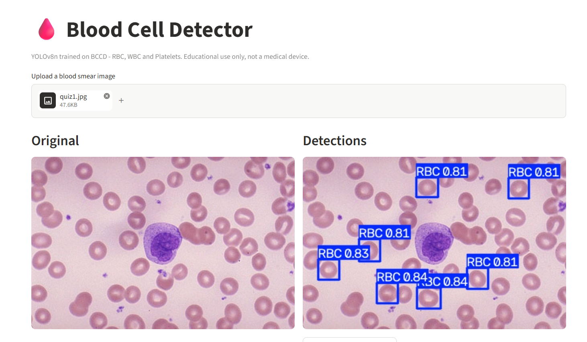

# Blood Cell Detector 

[](https://www.python.org/)
[](https://github.com/ultralytics/ultralytics)
[](https://streamlit.io/)
[](LICENSE)

A deep learning application that detects and counts **red blood cells (RBC)**, **white blood cells (WBC)** and **platelets** in peripheral blood smear microscopy images.

A YOLOv8n object detector was fine-tuned on the public BCCD dataset and wrapped in a small Streamlit app: upload an image, get bounding boxes and a count for each cell type, and download the annotated result.

**Built with:** Python · Ultralytics YOLOv8n · PyTorch · Streamlit · OpenCV · Google Colab

> [!IMPORTANT]
> This is an educational and research project. It is **not** a medical device and must not be used for clinical diagnosis.

## Demo



*The app running locally on a blood smear image from outside the BCCD dataset. On unfamiliar images like this one the model finds only some of the cells; see [Limitations](#limitations).*

## Features

- Detection of blood cells in microscopy images
- Separate counts for RBC, WBC and platelets, plus a total
- Bounding boxes with class labels and confidence scores
- Adjustable confidence threshold
- Image upload (JPG, PNG, BMP)
- Download of the annotated image as PNG
- A single-page Streamlit interface that runs on a CPU-only laptop

## Model architecture

| | |
|---|---|
| Model | [YOLOv8n](https://docs.ultralytics.com/models/yolov8) (nano), about 3 million parameters |
| Approach | Transfer learning from the pretrained `yolov8n.pt` checkpoint |
| Classes | `RBC`, `WBC`, `Platelets` |
| Epochs | 15 |
| Image size | 416 |
| Batch size | 8 |
| Random seed | 42 |
| Hardware | Tesla T4 GPU (Google Colab) |
| Framework | Ultralytics 8.4.215 |

## Dataset

The model was trained on [BCCD (Blood Cell Count and Detection)](https://github.com/Shenggan/BCCD_Dataset), a small public dataset of annotated blood smear images.

- 364 images, 640 × 480 pixels
- Pascal VOC XML annotations, converted to YOLO format by the training notebook
- Two annotations with zero-area boxes were dropped during conversion

| Split | Images | Share |
|---|---|---|
| Training | 254 | 70% |
| Validation | 72 | 20% |
| Testing | 38 | 10% |

The split is random with a fixed seed, so it is reproducible.

## Model performance

Results on the held-out test set: 38 images containing 511 annotated objects. The model never saw these images during training.

| Class | Precision | Recall | mAP@50 | mAP@50:95 |
|---|---|---|---|---|
| **Overall** | 0.831 | 0.906 | 0.930 | 0.642 |
| RBC | 0.772 | 0.861 | 0.911 | 0.644 |
| WBC | 0.957 | 1.000 | 0.994 | 0.793 |
| Platelets | 0.763 | 0.857 | 0.886 | 0.487 |

How to read these numbers:

- **Precision**: of the boxes the model drew, the fraction that were correct.
- **Recall**: of the cells that were annotated, the fraction the model found.
- **mAP@50**: average precision across confidence thresholds, counting a detection as correct when its box overlaps the annotation with an IoU of at least 0.50.
- **mAP@50:95**: the same measure averaged over stricter overlap thresholds from 0.50 to 0.95, so it also rewards precise box placement.

mAP@50 is a detection-quality metric, **not counting accuracy**. A mAP@50 of 0.930 does not mean the cell counts are 93% correct: counts depend on the chosen confidence threshold, and missed or duplicated detections change them directly.

## Installation

**Requirements:** Python 3.11 or newer (developed on Python 3.11). No GPU is needed to run the app.

Clone the repository, then create a virtual environment and install the dependencies.

**Windows (PowerShell)**

```powershell
py -3.11 -m venv .venv
.\.venv\Scripts\python.exe -m pip install -r requirements.txt
```

**macOS / Linux**

```bash
python3 -m venv .venv
source .venv/bin/activate
pip install -r requirements.txt
```

`requirements.txt` lists only `ultralytics` and `streamlit`; PyTorch and OpenCV are installed automatically as dependencies of Ultralytics.

The trained weights are included at `models/best.pt` (about 6.5 MB), so the app works without retraining.

## Usage

1. Start the application.

   Windows:

   ```powershell
   .\.venv\Scripts\python.exe -m streamlit run app.py
   ```

   macOS / Linux:

   ```bash
   streamlit run app.py
   ```

2. Open http://localhost:8501 in a browser and upload a blood smear image.
3. Adjust the **Confidence threshold** slider in the sidebar. Lower values show more detections, higher values keep only the most confident ones.
4. View the original image next to the detections, with the RBC, WBC, platelet and total counts below.
5. Click **Download annotated image** to save the result as a PNG.

## Training

The model was trained in Google Colab with [`train_colab.ipynb`](train_colab.ipynb). To reproduce it:

1. Download `BCCD_Dataset-master.zip` from the [BCCD repository](https://github.com/Shenggan/BCCD_Dataset) (**Code → Download ZIP**).
2. Open `train_colab.ipynb` in [Google Colab](https://colab.research.google.com/) and select a GPU runtime (**Runtime → Change runtime type → T4 GPU**).
3. Run the cells from top to bottom and upload the ZIP file when prompted.

The notebook converts the annotations to YOLO format, creates the 70/20/10 split, trains YOLOv8n, evaluates it on the test set and downloads `best.pt`. Copy that file into the `models/` folder.

[`train.py`](train.py) is an optional script for training locally on a dataset that is already in YOLO format:

```bash
python train.py --data path/to/data.yaml --epochs 15
```

## Project structure

```
blood-cell-detector-yolov8/
├── app.py               # Streamlit application
├── train.py             # Optional local training script
├── train_colab.ipynb    # Google Colab training notebook
├── requirements.txt     # Python dependencies
├── models/
│   └── best.pt          # Trained YOLOv8n weights
├── assets/
│   └── demo.png         # Application screenshot
├── LICENSE
└── README.md
```

## Limitations

- **Small dataset.** The model was trained on 254 images and tested on 38, so the reported metrics have wide uncertainty.
- **Limited generalization.** All BCCD images share similar staining, magnification and camera settings.
- **Unfamiliar images.** Performance drops on microscopy images that look different from BCCD, as the screenshot above shows.
- **Not a blood count.** The app counts cells visible in one image. This is not equivalent to a clinical complete blood count (CBC), which measures cell concentrations in a blood sample.
- **Educational and research use only.** The project is not validated for clinical use and must not be used for diagnosis.

## Acknowledgments

- [BCCD Dataset](https://github.com/Shenggan/BCCD_Dataset) by Shenggan and contributors (MIT License)
- [Ultralytics YOLO](https://github.com/ultralytics/ultralytics) (AGPL-3.0)
- [Streamlit](https://streamlit.io/) (Apache-2.0)

## License

The source code in this repository is released under the [MIT License](LICENSE).

The project depends on Ultralytics YOLO, which is licensed under AGPL-3.0. The trained weights in `models/best.pt` were produced with Ultralytics from the pretrained `yolov8n.pt` checkpoint and are distributed under the [AGPL-3.0 license](https://www.gnu.org/licenses/agpl-3.0.html).
